# Hey 👋 What's up?

My name is Rodrigo and I'm a computer engineer from Santiago, Chile.

## About me

I'm a Full Stack Developer.

## Social

  
  
  

## Tech Stack

  
  
  

## Most Used

  

  

## Game Over!

<picture>
  <source media="(prefers-color-scheme: dark)" srcset="https://raw.githubusercontent.com/Hrodrico/Hrodrico/output/pacman-contribution-graph-dark.svg">
  <source media="(prefers-color-scheme: light)" srcset="https://raw.githubusercontent.com/Hrodrico/Hrodrico/output/pacman-contribution-graph.svg">
  
</picture>

